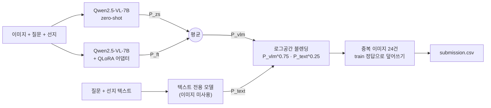

# 재활용품 이미지 VQA — SSAFY 16기 1회차 AI 챌린지

한국어 재활용품 사진에 대한 **4지선다 Visual Question Answering**.
Qwen2.5-VL-7B를 4bit로 올려 단일 소비자용 GPU에서 QLoRA 파인튜닝·추론했습니다.

| 리더보드 | 점수 |
|---|---|
| **Public** | **0.86322** |
| **Private** | **0.85494** |

> 베이스라인 Public 0.68979 → **0.86322 (+17.3%p)**

---

## 1. 요약

- **문제**: 이미지 + 한국어 질문 + 선지 4개 → 정답 `a`/`b`/`c`/`d`, 평가 지표 Accuracy
- **모델**: Qwen2.5-VL-7B-Instruct, 4bit NF4 + LoRA(r=16), 입력 640px
- **핵심 전략**
  1. 생성(`generate`) 대신 **정답 위치 로짓에서 a/b/c/d 4개 토큰만 비교** — 파싱 실패 0, 추론 수십 배 단축
  2. **정답 글자 1토큰에만 loss** 를 거는 QLoRA — 학습과 추론을 정확히 일치
  3. 파인튜닝·zero-shot 확률 평균 + **이미지를 보지 않는 텍스트 모델과 로그공간 블렌딩**
  4. train/test **중복 이미지** 정답 이식 (24건)
- **평가 방법**: train을 층화 분할한 홀드아웃 609건. 탐색하지 않은 구성에서 리더보드와 ±0.2%p 이내로 일치
- **환경**: RTX 5060 Ti 16GB(1일차) → RTX 5060 Laptop 8GB + Colab 무료 T4(2일차), Windows

---

## 2. 제출 이력

| # | 구성 | 홀드아웃 609 | Public | 증분 |
|---|---|---|---|---|
| 1 | 제공 베이스라인 (3B 4bit / 384px / `generate`) | — | 0.68979 | — |
| 2 | 3B bf16 / 640px / **로짓 스코어링** | 0.7504 | 0.76823 | +7.84%p |
| 3 | **7B** 4bit / 640px (zero-shot) | 0.8276 | 0.82900 | +6.08%p |
| 4 | + 텍스트 모델 블렌딩 + 중복 이미지 | 0.8424 | 0.84430 | +1.53%p |
| **5** | **+ QLoRA 파인튜닝 & zero-shot 평균** | **0.8621** | **0.86322** | **+1.89%p** |
| 6 | + 카운팅 문항만 768px | 0.8801 | 0.86164 | −0.16%p (기각) |

**최종 선택은 5번 (Private 0.85494).** 6번은 홀드아웃이 크게 올랐지만 리더보드에서 떨어졌습니다 —
[§6](#6-실패에서-배운-것)에서 이유를 분석합니다.

---

## 3. 문제 정의와 데이터 분석

| | |
|---|---|
| 데이터 | train 5,073 / dev 4,413 / test 5,074 |
| 문항 유형 | **카운팅 34%** · 재질 34% · 색 9% · 종류 6% · 기타 |
| 입력 | 휴대폰 촬영 사진(중앙값 720×960) + 질문 + 선지 4개 |

모델을 만들기 전에 데이터를 먼저 측정했고, 여기서 나온 세 가지가 전략을 정했습니다.

**① 이미지를 안 봐도 0.57이 나옵니다.** 질문+선지 텍스트만으로 TF-IDF + 로지스틱 회귀를 돌리면
0.5655 (랜덤 0.25). 카운팅 정답이 특정 값에 크게 쏠리는 등 **선지 구조 자체에 편향**이 있습니다.
이 값은 "이미지를 실제로 쓰고 있는가"의 판정선이 됐고, 나중엔 블렌딩 파트너가 됐습니다.

**② `dev.csv`는 검증에 쓸 수 없습니다.** `answer1~5`는 정답이 아니라 교육생 응답입니다.
응답자 간 일치도 37.5%, 5인 만장일치 0.02%로 독립 응답 모델로도 설명되지 않고,
카운팅 비율도 71%로 test(34%)와 다릅니다.

**③ train과 test는 분포가 같습니다.** 카운팅 비율(34.4% / 33.8%)과 정답 위치 분포가 일치해,
train을 **정답 위치 × 문항 유형**으로 층화 분할한 홀드아웃 609건을 만들었습니다.

---

## 4. 솔루션 구조



모든 모델은 문항마다 **a/b/c/d 네 개의 확률**을 냅니다. 확률 파일(`.npy`)을 저장해 두면
조합을 바꿀 때마다 GPU를 다시 쓸 필요가 없습니다.

---

## 5. 핵심 아이디어

### 5-1. 생성하지 않고 로짓 4개만 비교

베이스라인은 `generate(max_new_tokens=2)` 후 문자열을 파싱하고, 실패하면 무조건 `a`를 반환했습니다.
이를 **assistant 헤더 직후 위치의 로짓에서 `a`/`b`/`c`/`d` 토큰 4개만 softmax** 하도록 바꿨습니다.

```
학습:  [시스템 + 이미지 + 질문 + 선지 + assistant 헤더] + "b"   ← 마지막 토큰 1개에만 loss
추론:  [시스템 + 이미지 + 질문 + 선지 + assistant 헤더]        ← 마지막 위치 로짓에서 a~d 비교
```

정답 뒤에 `<|im_end|>`를 붙이지 않아 학습이 곧 **단일 토큰 4지 분류**가 되고, 학습·추론이 정확히 일치합니다.
추론 시에는 `logits_to_keep=1`로 마지막 위치 로짓만 계산해 메모리를 아낍니다(결과 동일함을 코드로 검증).

### 5-2. 베이스라인에서 고친 것

| 문제 | 영향 | 수정 |
|---|---|---|
| 프롬프트·이미지 토큰까지 전부 loss | 정답 1토큰이 300여 토큰에 묻혀 학습 신호 소멸 | 정답 위치만 남기고 `-100` 마스킹 |
| `generate` + 파싱 실패 시 `a` | 오답 + 30~60분 추론 | 로짓 스코어링 |
| 5,073개 중 200개만 학습, 검증 지표가 loss | 모델 선택 불가 | 학습 샘플 확대, 홀드아웃 accuracy로 검증 |
| `device_map="auto"` | VRAM 부족 시 조용히 CPU/meta 오프로드 | `{"": 0}` 고정 + 오프로드 검사 |

### 5-3. 모델 크기가 가장 큰 단일 이득

| 홀드아웃 609 | 3B bf16 | **7B 4bit** |
|---|---|---|
| 전체 | 0.7504 | **0.8276** |
| 카운팅 | 0.6190 | 0.6857 |
| 기타 | 0.8195 | 0.9023 |

16GB에 7B bf16(16.6GB)은 들어가지 않아 4bit가 필수였습니다. 반대로 3B는 bf16이 4bit보다 빠르고 정확했습니다.

### 5-4. 파인튜닝 + zero-shot 평균

QLoRA 104 optimizer step(학습 데이터의 19%, 33분)만으로 홀드아웃 +2.75%p.
여기에 **같은 모델의 zero-shot 확률을 단순 평균**하면 +0.66%p가 더 나왔습니다.
zero-shot test 확률은 이미 저장돼 있어 추가 비용은 0이었습니다.

| 설정 | 값 |
|---|---|
| 양자화 | 4bit NF4, double quant, compute dtype bf16 |
| LoRA | r=16, α=32, dropout 0.05, q/k/v/o/gate/up/down |
| 학습 | batch 1 × grad accum 8, lr 1e-4, cosine, warmup 3%, grad ckpt |
| 증강 | 밝기 ±25% · 대비·채도 ±20% · 회전 ±8° |

### 5-5. 텍스트 전용 모델 블렌딩

VLM이 무시하는 **선지 구조 편향**을 텍스트 모델이 잡으므로, 로그공간에서 가중 기하평균합니다.

```
P = P_vlm^α · P_text^(1-α),   α = 0.75
```

이득은 카운팅에 집중됐습니다. 카운팅에서 텍스트 모델(0.62)과 VLM(0.69)의 격차가 가장 작아
앙상블 효과가 가장 큰 곳이었습니다.

---

## 6. 실패에서 배운 것

성공한 것보다 실패한 것이 더 많았고, 더 많은 걸 알려줬습니다.

### 추론 단계에서 한 시도는 전부 실패했습니다

| 시도 | 홀드아웃 609 | 판정 |
|---|---|---|
| 카운팅: 숫자 토큰 직접 스코어링 | 0.6818 < 글자 0.6919 | ❌ |
| 저신뢰 문항 2지선다 재질의 | −1.81%p | ❌ |
| 선지 순서 TTA (파인튜닝 후) | −0.16%p | ❌ zero-shot에선 +0.99%p였음 |
| 좌우반전 TTA · 512/768px 앙상블 | +0.3~0.8%p | ❌ 노이즈 |
| 블렌딩 가중치·온도·α 재탐색 | 최대 +0.49%p | ❌ 노이즈 |
| 카운팅 **Chain-of-Thought** | **−8.57%p** (p=0.027) | ❌ 유의하게 악화 |
| 카운팅만 768px | +1.81%p → **Public −0.16%p** | ❌ 선택 편향 |

**CoT가 유의하게 나빴다는 것**이 가장 흥미로웠습니다. 모델은 실제로 "1번 병, 2번 병, 3번 병…" 하고
단계별로 세는데 답은 더 자주 틀렸습니다. 모델에게 없던 건 *세는 방법*이 아니라 *세는 능력*이었고,
선지 구조를 이용하는 편법이 실제 계수보다 정확했습니다.

**선지 순서 TTA가 파인튜닝 후 효과를 잃은 것**도 같은 이야기입니다. zero-shot 모델의 선지 위치 편향을
상쇄하던 기법이, 파인튜닝이 그 편향을 흡수하자 무의미해졌습니다.

### 홀드아웃은 "몇 개 중에서 골랐는가"에 따라 믿을 수 있습니다

| 구성 | 어떻게 골랐나 | 홀드아웃 | Public | 차이 |
|---|---|---|---|---|
| 7B zero-shot | 사전 고정 | 0.8276 | 0.82900 | +0.14%p |
| + 텍스트 블렌딩 | α 한 개 값을 1차원으로 탐색 | 0.8424 | 0.84430 | +0.19%p |
| + 파인튜닝·zs 평균 | 6개 중 선택 | 0.8621 | 0.86322 | +0.11%p |
| 카운팅만 768px | **성격이 다른 구성 30개 이상 중 최대** | 0.8801 | 0.86164 | **−1.85%p** |

α처럼 인접한 값끼리 결과가 비슷한 1차원 탐색은 거의 부풀려지지 않았습니다. 반면 해상도·앙상블 조합·
유형별 분할처럼 **서로 다른 구성을 30개 넘게** 같은 609건에서 재고 최대값을 고르면, 표준오차 ±2.0%p
기준으로 대략 +1.8%p가 부풀려집니다. 관측된 차이와 정확히 맞습니다. 사후에 계산한 p값(0.035)도 다중비교를 보정하면 의미가 없습니다.
"원래 예측했던 메커니즘이니 탐색이 아니다"라는 서사로 스스로를 설득한 것이 실수였습니다.

그 뒤로는 **평가 전에 구성을 하나만 정해 두고**, 10개 넘게 비교했다면 그 홀드아웃으로는 판단하지 않았습니다.

---

## 7. 파일 구성

```
.
├── common.py              경로 · 모델/LoRA 설정 · 프롬프트 · 블렌딩 공통 함수
├── make_holdout.py        ① 층화 홀드아웃 609건 id 생성
├── infer.py               ② VLM 확률 계산 (zero-shot / 어댑터, 재개 가능)
├── text_model.py          ③ 텍스트 전용 모델 확률
├── find_duplicates.py     ④ train/test 중복 이미지 정답 이식
├── make_submission.py     ⑤ 확률 결합 → 제출 파일
│
├── notebooks/
│   ├── train_and_zeroshot_desktop.ipynb   16GB GPU용 메인 노트북 (학습·zero-shot·스모크 테스트)
│   └── colab_train_resume.ipynb           Colab T4 학습 이어가기 (옵티마이저 상태까지 저장·재개)
│
├── experiments/           실험 원본 코드 (기각된 것 포함, 수정하지 않고 보존) — 자체 README 참고
├── docs/
│   └── DEVELOPMENT_LOG.md 실험 순서대로 쓴 상세 개발 기록
├── requirements.txt
└── .gitignore
```

---

## 8. 환경

| | 실험 환경 |
|---|---|
| GPU | RTX 5060 Ti 16GB / RTX 5060 Laptop 8GB (추론만) / Colab T4 16GB (학습) |
| OS | Windows 11 |
| Python | 3.12 (데스크탑) / 3.11 (노트북) |
| PyTorch | 2.13.0+cu130 (데스크탑) / 2.11.0+cu128 (노트북) |
| transformers / peft | 4.57.6 / 0.20.0 |

```bash
python -m venv .venv && .venv\Scripts\activate          # Windows
pip install torch torchvision --index-url https://download.pytorch.org/whl/cu128
pip install -r requirements.txt
```

> - **RTX 50 시리즈(Blackwell)** 는 cu128 이상이 필요합니다. cu130 휠은 드라이버 580 이상을 요구하므로
>   `nvidia-smi` 의 CUDA 버전을 먼저 확인하세요.
> - **transformers 5.x** 는 `AutoModelForVision2Seq` 가 제거돼 코드가 대체 클래스로 동작하지만,
>   실험은 4.57.6 에서 했습니다.
> - VRAM: 추론 8GB(batch 2, 로드 후 여유 0.8GB) / 학습 16GB(batch 1).

---

## 9. 데이터 준비

대회 데이터는 저작권 문제로 포함하지 않습니다. 대회 페이지에서 받아 아래처럼 둡니다.

```
data/
├── train.csv            id, path, question, a, b, c, d, answer
├── test.csv             id, path, question, a, b, c, d
├── sample_submission.csv
├── train/  train_0001.jpg ...
└── test/   test_0001.jpg ...
```

다른 위치를 쓰려면 `DATA_DIR`, 출력 위치는 `OUTPUT_DIR` 환경변수로 바꿉니다.

> 제출 파일의 `id`는 **확장자를 포함**합니다(`test_0001.jpg`).

---

## 10. 실행 방법

```bash
# ① 홀드아웃 609건 (CPU, 수 초)
python make_holdout.py

# ② zero-shot 확률 (8GB GPU 기준 홀드아웃 7분 · test 60분)
python infer.py --split holdout --zeroshot
python infer.py --split test    --zeroshot

# ③ QLoRA 학습 — 16GB GPU 또는 Colab
#    notebooks/train_and_zeroshot_desktop.ipynb 로 모델을 올린 뒤
#    experiments/notebook_cells/finetune_check.py 를 셀로 실행 (최종 제출: 104 step)
#    Colab 에서 이어서 학습하려면 notebooks/colab_train_resume.ipynb
#    결과 폴더(adapter_model.safetensors)를 checkpoints/lora_7b_ft/ 에 둡니다

# ④ 어댑터 확률
python infer.py --split holdout --adapter checkpoints/lora_7b_ft
python infer.py --split test    --adapter checkpoints/lora_7b_ft

# ⑤ 텍스트 모델 · 중복 이미지 (CPU)
python text_model.py
python find_duplicates.py

# ⑥ 제출 파일
python make_submission.py \
    --ft   outputs/probs_lora_7b_ft_test.npy \
    --zs   outputs/probs_zs_test.npy \
    --text outputs/text_probs_test.npy
```

`infer.py` 는 2분마다 체크포인트를 저장하므로 중단돼도 같은 명령으로 이어서 실행됩니다.
`--limit 20` 으로 몇 건만 먼저 돌려 동작을 확인할 수 있습니다.
`make_submission.py` 는 같은 이름의 `_holdout.npy` 가 있으면 홀드아웃 정확도도 출력합니다.

---

## 11. 재현성

공개 전에 정리한 스크립트가 실제 대회 산출물을 재현하는지 확인했습니다.

| 확인 항목 | 결과 |
|---|---|
| `make_holdout.py` → 홀드아웃 id | 원본과 **순서까지 일치** (609건) |
| `find_duplicates.py` → 중복 정답 | 원본과 **완전 일치** (24건) |
| `make_submission.py` ← 저장된 확률 | Public 0.86322 제출 파일과 **5,074행 전부 일치** |
| `infer.py --adapter` (20건) | 대회 당시 확률과 예측 20/20 일치, 평균절대차 0.003 |
| `infer.py --zeroshot` (20건) | 대회 당시 확률과 예측 20/20 일치, 평균절대차 0.005 |

**한 가지 차이가 있습니다.** 최종 제출에 쓴 텍스트 모델(홀드아웃 0.6355)의 학습 코드는
보존되지 않았습니다. `text_model.py` 는 같은 목적으로 다시 구현한 것으로 홀드아웃 **0.6141** 입니다.
그래서 처음부터 다시 돌리면 최종 점수와 약간 다를 수 있습니다.

GPU·torch 버전이 다르면 확률값이 소수점 셋째 자리 수준에서 달라질 수 있습니다.

---

## 12. 트러블슈팅

| 증상 | 원인 | 해결 |
|---|---|---|
| `expected device meta but got cuda:0` | 같은 커널에서 모델을 두 번 로드 → `device_map="auto"` 가 일부 레이어를 meta로 오프로드 | `device_map={"": 0}`, 로드 전 `del` + `empty_cache`, meta/cpu 파라미터 검사 |
| 학습 속도가 갑자기 2배 느려짐 | Windows WDDM이 VRAM 초과분을 시스템 RAM으로 조용히 스필 | gradient checkpointing 유지, VRAM 여유 확보 |
| T4에서 161 s/step | `torch.cuda.is_bf16_supported()` 가 에뮬레이션도 True → T4에서 bf16 에뮬레이션 | compute capability ≥ 8 일 때만 bf16, 아니면 fp16 + GradScaler (38 s/step) |
| 스크립트가 에러 없이 멈춤 (GPU 0%, 디스크 0) | 모델 캐시 환경변수보다 `transformers` 를 먼저 import → 16GB 재다운로드 대기 | 캐시 설정 모듈을 가장 먼저 import |
| cu130 휠에서 세그폴트 | CUDA 13.0 은 드라이버 580+ 필요 | cu128 휠 사용 |
| 어댑터를 올렸는데 성능이 그대로 | `PeftModel.from_pretrained` 로 다시 감싸 LoRA 이중 주입 / 로드 실패 | state_dict 만 로드, `lora_B` 절대합이 0이 아닌지 검사 |
| 파인튜닝 모델에 CoT를 시켜도 바로 답만 출력 | 단일 글자 출력으로 학습한 어댑터가 프롬프트 지시를 이김 | 응답 앞부분을 추론 문장으로 프리필 |

---

## 13. 회고

**잘한 것**
- 모델보다 **데이터를 먼저 측정**했습니다. 텍스트만으로 0.57, dev 라벨 불신, train/test 분포 일치 —
  이 세 가지가 이후 모든 판단의 근거가 됐습니다.
- 확률 파일을 저장하는 구조 덕분에 앙상블·블렌딩 실험을 GPU 없이 수 초 만에 반복했습니다.
- 실패한 실험도 원인까지 기록했습니다. 2지선다 재질의가 텍스트 모델 기여를 지워 실패했다는 분석이
  바로 다음 TTA 설계에 반영됐습니다.

**아쉬운 것**
- 파인튜닝을 오랫동안 "효과 없음"으로 착각했습니다. 로그의 `+0.00%p` 는 사실 **학습이 실행되지 않았다**는
  뜻이었습니다. 실행되지 않은 것과 효과가 없는 것을 구분하지 못해 가장 좋은 방향을 늦게 열었습니다.
- 추론 단계 튜닝에 너무 많은 시간을 썼고, 같은 홀드아웃을 과하게 탐색해 선택 편향에 한 번 속았습니다.
  파인튜닝에 GPU 시간을 더 일찍 몰았어야 했습니다.
- 텍스트 모델 학습 코드를 노트북 세션에만 두어 잃어버렸습니다. 결과 파일만큼 코드도 저장해야 합니다.

---

## 14. 공개 범위

- **포함**: 전처리·학습·추론·앙상블·제출 코드, 노트북(출력 제거), 실험 기록
- **제외**: 대회 데이터(이미지·CSV), 모델 가중치와 LoRA 어댑터, 확률 파일, 제출 CSV,
  주최측이 제공한 베이스라인 코드와 환경 설정 문서

대회 데이터와 제공 자료의 저작권은 주최측에 있습니다.
